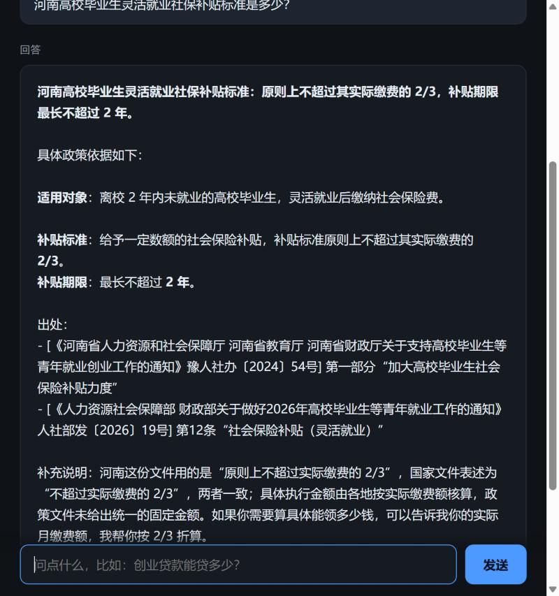

# 大学生就业创业政策问答服务

把政府公开的高校毕业生就业补助政策做成一个可调用的问答服务：别的程序接进来，就能用自然语言问政策。

**核心特点：答案必须带原文出处，找不到就说找不到，不瞎编。**



> 想看每个模块为什么这么写 → [代码导读](docs/CODE_GUIDE.md)

---

## 它解决什么问题

政策文件又多又长，学生找不到、看不懂、也记不住哪条还生效。

直接问大模型有两个毛病：

1. 它没读过这些文件，会编
2. 政策有时效性，模型不知道哪版作废了

RAG 的做法是：先从文件里检索出相关段落，再让模型**照着这些段落**回答，并标出出处。

---

## 架构

```
                      ┌────────────────────┐
   其他系统 ────────► │     HTTP 服务       │  /ask  /agent  /ingest  /health
                      └─────────┬──────────┘
                                │
                 ┌──────────────┴───────────────┐
                 │                              │
        ┌────────▼────────┐            ┌────────▼────────┐
        │   RAG 单次问答    │            │   Agent 循环     │
        │ 检索 → 拼材料 → 答 │            │ 想→调工具→再看   │
        └────────┬────────┘            └────────┬────────┘
                 │                              │
                 └──────────────┬───────────────┘
                                │
        ┌───────────────────────┼───────────────────────┐
        │                       │                       │
  ┌─────▼─────┐          ┌──────▼──────┐        ┌──────▼──────┐
  │ 向量检索   │          │ 关键词检索   │        │  DeepSeek   │
  │ bge-zh    │          │  TF-IDF     │        │  生成/工具调用│
  └─────▲─────┘          └──────▲──────┘        └─────────────┘
        │                       │
        └───────────┬───────────┘
                    │
             ┌──────┴──────┐
             │ 政策 txt 语料 │
             └─────────────┘
```

## 目录

```
policy-qa/
├── core/
│   ├── config.py      读 .env、路径、参数
│   ├── chunker.py     政策文件 → 按条款切块
│   ├── retriever.py   建索引 + 检索（关键词 / 向量 / 合并）
│   ├── rag.py         单次问答
│   └── agent.py       Agent 循环 + 工具定义
├── server/
│   ├── app.py         FastAPI 接口
│   └── static/        网页界面
├── sdk/
│   └── client.py      Python 客户端
├── tools/
│   └── fetch_policy.py  从政府网站抓政策
├── scripts/
│   ├── build_index.py   重建索引
│   └── eval.py          评测准确率
├── data/
│   ├── raw/           政策原文 txt
│   └── index.pkl      检索索引
├── cli.py             命令行问答
└── requirements.txt
```

---

## 跑起来

```bash
pip install -r requirements.txt
```

在项目根目录建 `.env`：

```
DEEPSEEK_API_KEY=sk-你的key
```

首次运行会从 hf-mirror 下载中文向量模型 `bge-small-zh-v1.5`（约 90MB，只需一次）。

```bash
python scripts/build_index.py
python -m uvicorn server.app:app --port 8100
```

浏览器打开 http://127.0.0.1:8100

Windows 上也可以直接双击 `start.bat`。

---

## 两种问答模式

### 单次问答 `POST /ask`

检索一次，然后把材料交给模型回答。快，便宜。

```json
{"question": "创业担保贷款最高能贷多少？"}
```

### Agent 模式 `POST /agent`

模型自己决定调用哪些工具，可以多步：

```
问题：想跟同学合伙开公司，启动资金不够怎么办？
  → search_policy("创业担保贷款 个人额度")
  → search_policy("合伙创业 提高额度")
  → 综合两份结果作答
```

返回里带 `steps` 字段，能看到它调了什么、为什么。

工具集：

| 工具 | 作用 |
|---|---|
| `search_policy` | 检索政策原文片段 |
| `read_policy` | 读某份政策全文（按文号或文件名） |
| `calculate` | 安全四则运算（只允许数字和运算符，不执行任何代码） |

### Docker 部署

```bash
# 1. 设置 key（不要写进镜像）
export DEEPSEEK_API_KEY=sk-你的key

# 2. 构建并启动
docker compose up -d

# 3. 看状态
curl http://127.0.0.1:8100/health
```

镜像构建阶段会下载向量模型并预建索引，所以容器启动即可用，不用等。

`core/config.py` 优先读环境变量、其次读 `.env`，所以容器里通过 `environment` 传 key 也能识别。

---

## 快速体验

```bash
python scripts/demo.py          # Agent 模式，跑 5 个典型问题
python scripts/demo.py --fast   # 直接检索模式，更快
```

演示覆盖五种情况：国家层面政策、地方政策、跨文件对比、多步推理、超纲拒答。

---

## 接口总览

| 方法 | 路径 | 说明 |
|---|---|---|
| POST | `/ask` | 单次问答，返回答案 + 结构化来源 |
| POST | `/agent` | Agent 模式，返回答案 + 调用链 |
| POST | `/session/new` | 新建会话，返回 `session_id` |
| DELETE | `/session/{sid}` | 清空某个会话 |
| POST | `/ingest` | 重新扫描 `data/raw` 重建索引 |
| GET | `/health` | 文件数、切块数、会话数、缓存命中率 |

### 多轮对话

`/ask` 和 `/agent` 都接受可选的 `session_id`，带上它就能追问：

```
用户：创业担保贷款能贷多少？
助手：个人最高 30 万，小微企业最高 400 万……
用户：那期限呢？
       ↑ 系统先把它改写成"创业担保贷款的期限是多久"，再去检索
助手：个人不超过 3 年，小微企业不超过 2 年。
```

**为什么要改写：** "那期限呢" 这四个字里没有任何可检索的关键词，直接拿去做向量检索必然抓空。所以先用上文把它补成完整问句，再检索。这一步多花一次模型调用，但多轮问答没它基本没法用。

会话保留最近 6 轮，超出自动丢弃；1 小时不用过期，最多存 200 个会话。

### 结果缓存

单轮问答按问题缓存，同一个问题问第二次直接返回，不消耗 token。

多轮对话**不缓存**——答案依赖上文，缓存会串。

---

## C++ 客户端

服务是 HTTP 接口，任何语言都能接。`cpp-client/` 里是一份**不依赖任何第三方库**的 C++ 实现：

```bash
cd cpp-client
make
./policy-cli "创业担保贷款最高能贷多少？"
./policy-cli -a "想跟同学合伙开公司，启动资金不够怎么办？"   # Agent 模式
./policy-cli                                              # 交互模式
```

实现要点：

- 用原始 socket 手写 HTTP/1.1 请求，自行解析状态行、响应头、chunked 编码
- 自带极简 JSON 解析器（递归下降，支持转义与 `\uXXXX` 代理对）
- 处理 TCP 短写：`send` 循环直到发完
- 设置 `SO_RCVTIMEO` / `SO_SNDTIMEO`，服务无响应时不会永久阻塞

三个文件：`http.cpp`（网络）、`json.cpp`（解析）、`main.cpp`（命令行）。

---

## 在其他程序里用

```python
from sdk import PolicyClient

c = PolicyClient("http://127.0.0.1:8100")

a = c.ask("就业见习补贴是给谁的？")
print(a.answer)
print(a.refs())        # ['人社部发〔2026〕19号 | 人力资源社会保障部……']

b = c.agent("想跟同学合伙创业，贷款能提高额度吗？")
print(b.answer)
print(b.tools_used())  # ['search_policy', 'search_policy']
```

---

## 评测

26 条人工标注问题：21 条能答（含 6 条同义改写），5 条该拒答。

```bash
python scripts/eval.py all
```

实测结果（语料 56 份、725 块）：

| 检索方式 | 答案准确率 |
|---|---|
| 关键词 TF-IDF | 96.2% |
| 向量 bge-zh | 100% |
| 双路 RRF 合并 | 100% |
| Agent | 96–100%（多次运行有波动） |

**评测本身有 ±4% 的跑动波动。** 同一个问题，模型两次回答可能一个包含关键数字一个不包含，所以不要把这几个百分数当成精确值。关键词那一路唯一失手的是最难的改写题（「我自己开了个小店，政府会给钱吗」——关键词匹配不上「一次性创业补贴」）。

**加了一道查询前缀之后，向量和混合两路都到 100%。**

短问题（如「灵活就业社保补贴标准」）本身缺学科语境，直接拿去向量检索，正确答案会排到 20 名开外。在查询侧加一句领域前缀 `高校毕业生就业政策`，同一个问题正确答案从第 23 名升到第 1 名。

注意只加在**查询**上，文档侧不动——文档本身就在领域内，不需要再提醒。

> 说明：评测集是自己出的，题目用词贴近原文，所以 100% 是上限而不是真实分布下的期望值。

**语料扩容后踩的坑（重要）：**

语料从 9 份、89 块扩到 56 份、725 块之后，纯向量检索的 top3 召回从 100% 掉到 95.2%——候选多了 8 倍，相似片段更容易挤掉正确答案。把 `TOP_K` 从 5 调到 6 之后召回回到 100%。

**加了地方政策之后的第二个坑：** 问"一次性求职补贴谁能领"这种不指定地区的问题时，河南的政策会挤掉国家政策排到第一位，Agent 甚至引用了河南文号。加了一层**地区感知重排序**——问题里出现某个省就偏向该省，没出现就偏向国家级。这一步把关键词和向量的准确率都拉回了 100%。

**结论：检索参数和排序策略要跟着语料结构调，加一类数据就可能带出新的问题。**

---

## 关于地方政策

语料 = **34 份国家级 + 22 份河南省** = 56 份，725 个切块。

河南省可以自动抓，其他省份和城市暂时不行。原因和现状：

| 来源 | 情况 |
|---|---|
| 中国政府网 | ✅ 只收国务院及部委文件，**不含地方** |
| 河南省人社厅 | ✅ 有 JSON 列表接口，文章页静态 HTML，已接入 |
| 上海 / 广州 / 深圳人社局 | ⚠️ 能连，但页面 JS 动态渲染，抓不到正文 |
| 北京 / 杭州 / 成都 / 陕西 / 广东 | ❌ 超时或返回 403/412 |
| 江苏 / 山东 / 四川 / 湖北 / 安徽 | ⚠️ 站点可达，但政策栏目需逐个逆向，未接入 |

河南能抓通的原因：列表走 `jyxc.henan.gov.cn/open/documents` 的 JSON 接口（带 Referer 才能访问），文章页正文在 `title7` 之后的表格里，部分是 docx 附件——脚本会自动下载附件解出文字。

抓取脚本：`python tools/fetch_henan.py`（`--list` 只看不下载）。

**每条政策都带 `地区` 字段**，检索时按地区加权。问"河南的社保补贴"会优先命中河南文件；问"北京的补贴"而库里没有北京政策时，会明确说"没有北京的具体政策，以下是国家层面规定"，不会拿国家政策冒充地方政策。

**失效时间**：河南的政策页带失效日期，已一并抓取写入元信息。国家级的文件没有这个字段，标"未标注"。

加其他地区的政策，把 txt 放进 `data/raw/` 即可（格式见下一节）。

---

## 稳定性

**失败重试。** 所有模型调用走 `core/llm.py` 一个口，统一做指数退避重试：1s → 2s → 4s，每次带 ±50% 随机抖动。

为什么要抖动：多个请求同时失败时，如果都按固定间隔重试，会一起再打过去，把上游打得更惨。随机量能把重试摊开。

只对**有意义的错误**重试——网络超时、连接断开、429、5xx。参数错、鉴权错这类重试多少次都没用，直接抛。

**上下文压缩。** 对话超过 8 轮时，把最早的几轮交给模型压成 200 字摘要，只保留最近 6 轮原文。

为什么不直接丢：用户第一句说的「我是河南的应届生」如果丢了，后面几轮模型就不知道这个约束了。压成摘要能保住关键信息，又不让提示词无限变长。

压缩本身失败时退化成直接截断——宁可丢信息，也不能让历史无限涨。

**会话持久化。** 会话存在 `data/sessions.json`，进程重启后还在。写入用「先写临时文件再改名」，避免写到一半进程挂掉留下坏文件；文件损坏时当空处理，不会让服务起不来。

**流式输出。** `/ask/stream` 走 SSE，模型每生成一段就推一段，前端边收边显示。体感延迟从「等 1.7 秒」变成「0.3 秒开始出字」。

---

## 性能

`python scripts/bench.py 15` 实测（15 条不同问题，本机）：

| 指标 | 数值 |
|---|---|
| **首字延迟（中位）** | **约 600–900 ms**（波动较大） |
| 端到端延迟（中位） | 1326 ms |
| p90 / p99 | 1686 ms / 2928 ms |
| ├ 检索耗时 | **7.8 ms（占 0.6%）** |
| └ 生成耗时 | 1318 ms（调模型） |
| 单次 token | 约 1362（输入占 90%） |
| 缓存命中延迟 | **0 ms** |
| 1000 次调用成本 | 约 ¥2.7 |

**首字延迟才是流式场景下用户真正感知的指标**——用户看到第一个字就开始读了，后面生成多快影响不大。所以加了 `/ask/stream` 之后，体感从「等 1.3 秒」变成「半秒多开始出字」。

首字延迟波动很大（实测 482–944ms），主要受网络往返和模型排队影响，不是服务端能控的。

### 一次没有收益的优化（记下来，免得以后再试）

输入 token 占总量 90%，我怀疑是它拖慢了首字延迟，于是把 `TOP_K` 从 6 降到 4（材料从 6 块减到 4 块，输入 token 降 33%）。

同样的题、各跑 2 次对比：

| | 首字延迟 | 总延迟 |
|---|---|---|
| top_k=6 | 879 ms | 1635 ms |
| top_k=4 | 815 ms | 1748 ms |

**差异在噪声范围内**（同一配置连续跑也会有 ±200ms 波动）。说明首字延迟由网络往返和模型侧排队决定，不是输入长度。所以参数改回了 6——少两块会掉召回，换不来速度。

结论：**先测再改，不要凭直觉调参。**

**瓶颈完全在模型生成，检索已经可以忽略。**

### 检索性能是怎么优化出来的

第一版检索是纯 Python 循环：对 725 个向量逐个算点积。

```python
for i, vec in enumerate(index["dvecs"]):
    dot = sum(a * b for a, b in zip(q, vec))   # 慢
```

并发测试暴露了问题——1 并发 10 QPS，加到 16 并发还是 10 QPS，只是每个人等得更久（p50 从 98ms 涨到 1290ms）。

改成 numpy 矩阵乘：

```python
sims = index["dmat"] @ q / (index["dnorms"] * qn)
```

| | 优化前 | 优化后 |
|---|---|---|
| 单次检索 | 98 ms | **4 ms** |
| 1 并发 QPS | 10.2 | **274.6** |
| 16 并发 QPS | 10.7 | **800.8** |

**快了 24 倍。** 同样的硬件、同样的数据，只是不再用 Python 解释器逐条算浮点。

结论：这类密集数值计算不该手写循环，交给 numpy/BLAS 是常识，但只有真去压测才会发现它挡住了整个服务。

---

## 并发测试

```bash
python scripts/loadtest.py
```

只压检索链路（不调模型），测的是服务端的 CPU 瓶颈：

| 并发 | QPS | p50 | p99 |
|---|---|---|---|
| 1 | 274.6 | 4 ms | 4 ms |
| 4 | 640.5 | 6 ms | 7 ms |
| 8 | 753.3 | 10 ms | 13 ms |
| 16 | 800.8 | 16 ms | 36 ms |

并发扩展比约 3 倍（16 并发 vs 单并发），没有线性上升——因为检索是纯 CPU 密集型，多线程共享 GIL，加并发只是分摊核。

再往上要换多进程，或者改用带索引的向量库（FAISS / HNSW）。现在这个量级（725 块）没必要。

---

## 测试

```bash
python -m unittest discover -s tests -v    # Python：28 条
cd cpp-client && make test                 # C++：25 条
```

覆盖：

- **切块器**：按条款切、长块兜底切、碎块丢弃
- **地区重排**：问省问国家分别偏向哪边、不删候选
- **LRU 缓存**：命中、淘汰、访问顺序更新、TTL 过期
- **会话**：持久化、损坏文件容错、压缩阈值、摘要拼接
- **重试**：退避时间递增、有抖动、上限封顶、可重试/不可重试的区分
- **压缩**：触发条件、压缩后长度、压缩失败退化为截断
- **JSON 解析器**（C++）：对象、数组、转义、`\uXXXX` 代理对、空容器、嵌套、非法输入

写测试时抓到一个真 bug：JSON 解析器遇到 `{"a": }` 这种非法输入不报错，静默返回数字 0。已修——数字必须以 `-` 或数字开头，否则抛异常。

写测试时抓到一个真 bug：JSON 解析器遇到 `{"a": }` 这种非法输入不报错，静默返回数字 0。已修——数字必须以 `-` 或数字开头，否则抛异常。

---

## 加新政策

1. 把政策存成 txt 放进 `data/raw/`，开头写：

```
标题：xxx
地区：河南
发文机关：xxx
发文字号：xxx
发布日期：xxx
失效时间：xxx（没有就写"未标注"）
来源：xxx
```

`地区` 不写默认按"全国"处理。地方政策一定要写，否则会被当成国家政策。

2. 调 `POST /ingest` 或重跑 `python scripts/build_index.py`

也可以直接抓：

```bash
python tools/fetch_policy.py "https://www.gov.cn/zhengce/zhengceku/xxx/content_xxxx.htm"
```

---

## 设计上的几个决定

**按条款切块，不按字数切。**
政策文件是"1.xxx补贴 / 政策内容：……"这种结构。按固定字数切会把一条政策拦腰截断。按 `一、`、`1.` 这些编号切，每条政策是完整的一块。改完之后"就业见习补贴"的检索相似度从 0.26 涨到 0.46。

**先做关键词，再加向量。**
一开始只有 TF-IDF，能跑通再补向量。好处是每一步都能看见效果，而且关键词那版作为对照，后来才能测出向量到底好多少。

**地区重排序，不做地区过滤。**
问题里出现某个省，就让该省的政策加权 1.3，国家级加权 1.1；没出现就让国家级加权 1.15。为什么不直接过滤掉其他省？因为万一某个问题只有地方政策能回答，过滤掉就彻底查不到了。只调分数、不删候选，是这个取舍的关键。

**实现了 Rerank，但默认关闭。**
`core/rerank.py` 用 cross-encoder（bge-reranker-base）对粗召回结果逐对打分重排，原理上比向量检索准——它把问题和文档拼在一起送进模型，不像向量检索那样各编码一次从没见过面。

实测它确实更强：问「我自己开了个小店，刚开始做，政府会给钱吗」，重排前正确答案在榜外，重排后升到第 1。

但**没有默认开启**，因为太慢：

| 候选数 | 重排耗时 |
|---|---|
| 6 | 1.3 s |
| 10 | 2.1 s |
| 20 | 4.3 s |

对比：不加 rerank 时整条问答链路才 1.3 s。开着重排等于把延迟翻倍还多，而本项目的向量检索加了查询前缀之后已经能答对，收益体现不出来。

**结论：能力留着，默认关着，需要更高精度时改 `config.ENABLE_RERANK = True`。** 不是「没想到」，是「试过、量过、不用」。

**同一份文件最多取 2 块。**
否则 5 个来源全来自同一篇，信息冗余。

**模型拿不到材料就直说。**
`rag.py` 的系统提示写死了：材料里没有就回答"没有找到相关内容"。这条是整个项目最重要的一行——政策问答宁可说不知道，也不能编。评测里 5 条超纲问题全部拒答。

**`calculate` 只做四则运算。**
用 `ast` 解析表达式并白名单运算符，不调用 `eval`，避免执行任意代码。

**向量模型走 hf-mirror。**
HuggingFace 国内直连不通，`retriever.py` 里设了 `HF_ENDPOINT=https://hf-mirror.com`。

---

## 已知限制

- 地方政策只覆盖河南一省，其他省份需要单独对接数据源
- 政策失效只有「失效时间」字段，还没有做到自动剔除已作废文件
- 评测集是自己出的，题目用词贴近原文，准确率是上限，不代表真实分布；且多次运行有 ±4% 波动
- 单机单进程，未做多实例部署和故障转移
- 中文切块按标点和条款编号处理，没有做语义分块
- 没有鉴权、限流、配额，不适合直接暴露到公网

---

## 数据来源

中国政府网政策文件库（www.gov.cn）公开文件。